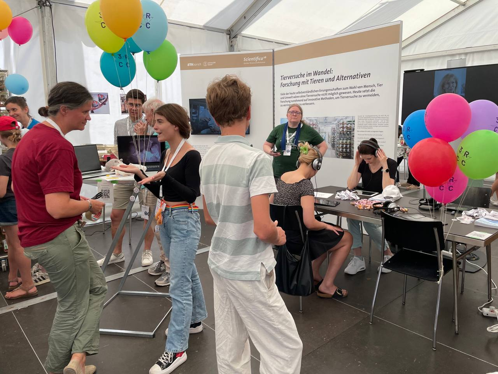
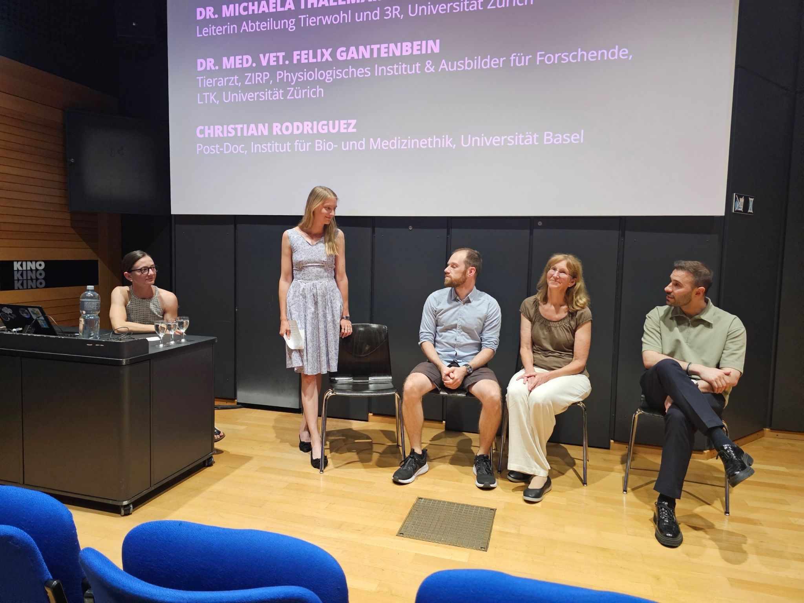
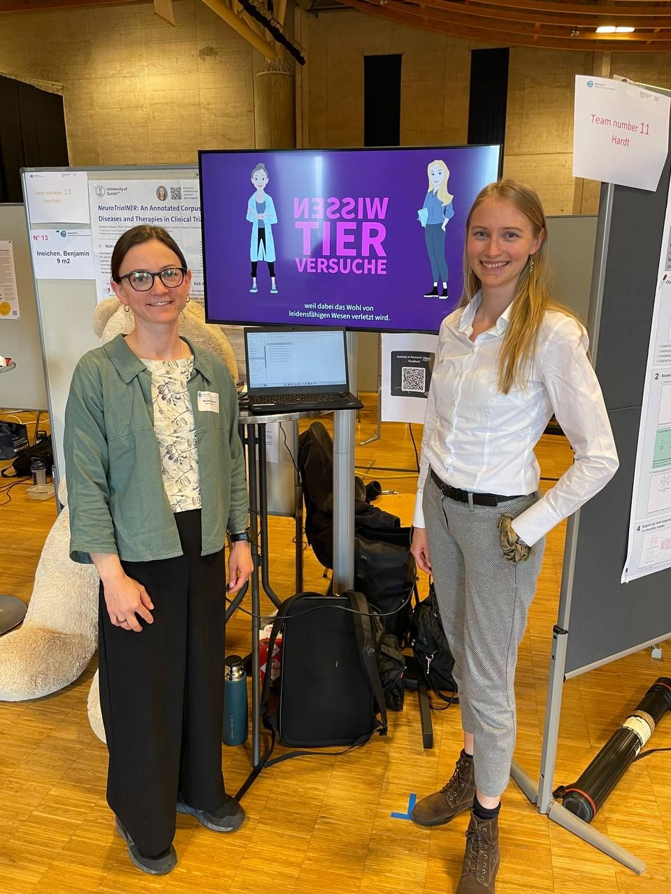
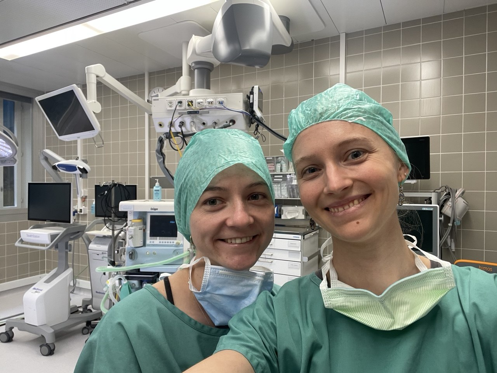
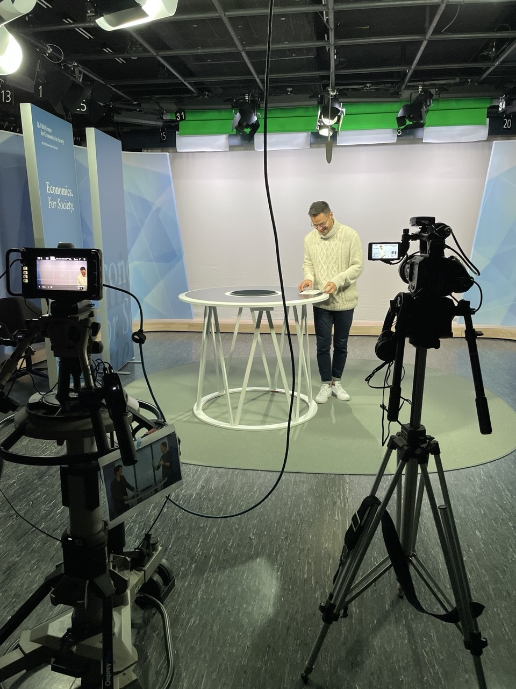
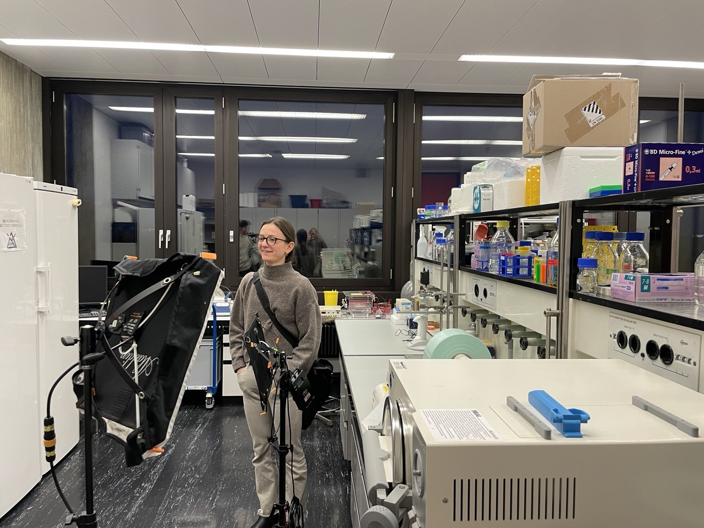
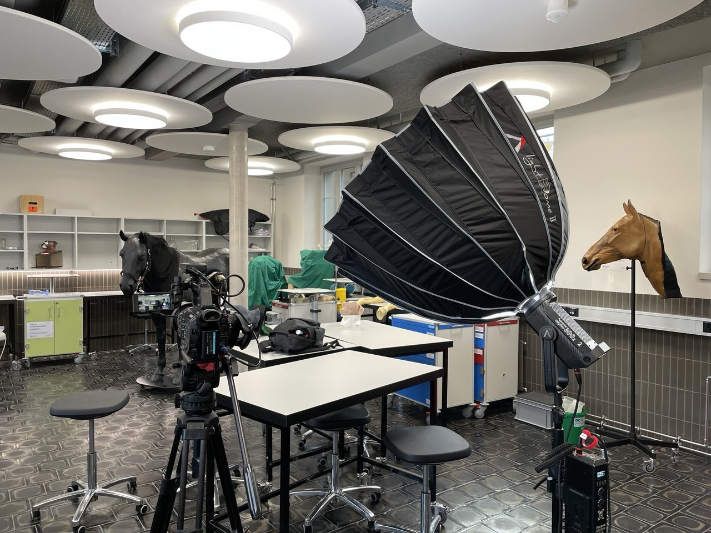
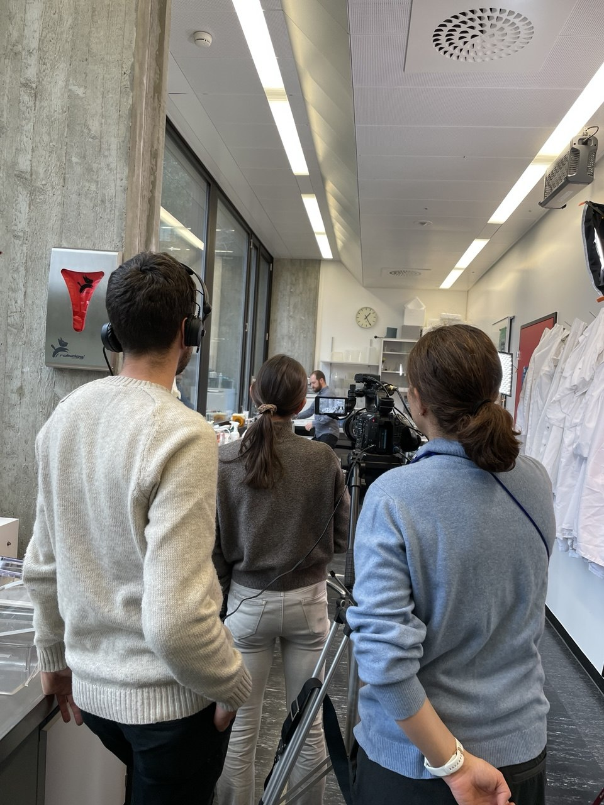
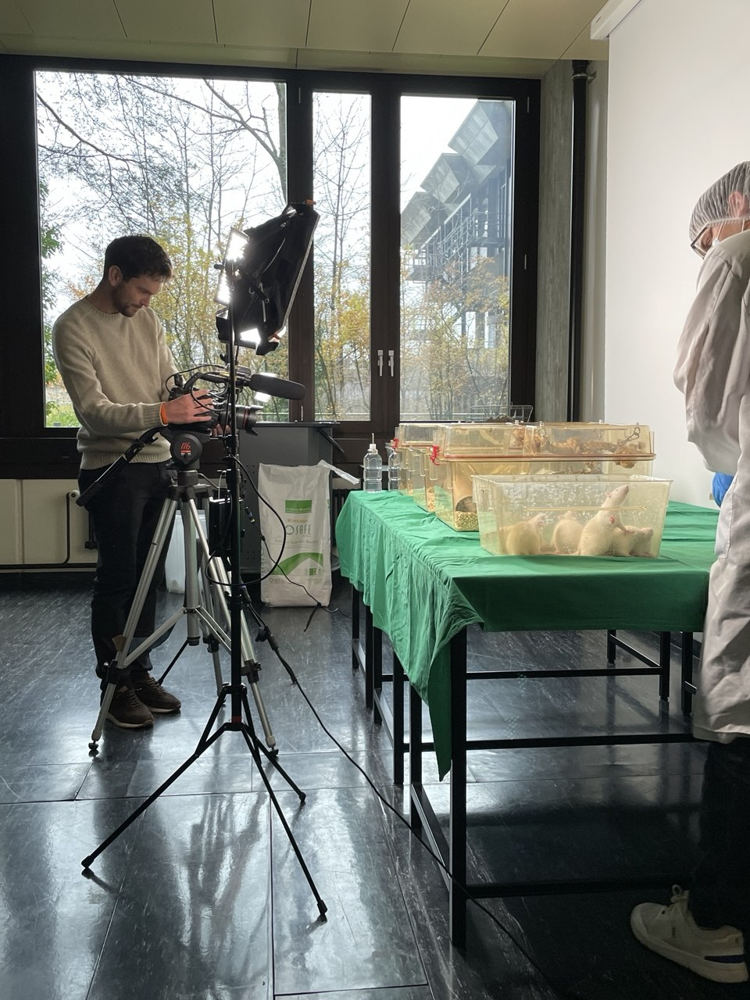

## Unsere Aktivitäten in Bildern

Entdecken Sie Impressionen von unseren Veranstaltungen und Outreach-Aktivitäten rund um das Projekt «Forschung mit Tieren in der Schweiz».

### Events & Outreach

::: {.gallery-grid}

::: {.gallery-item}

**Scientifica 2026**

Unser Projekt war Teil der Ausstellung «Animal Research in Transition: Research with Animals and Alternatives» an der Scientifica 2026 in Zürich. Die Ausstellung zeigte, wie Forschung mit Tieren und moderne Alternativmethoden zusammenspielen. Besucherinnen und Besucher aller Altersgruppen konnten unsere Videos vor Ort auf Tablets entdecken und mit uns ins Gespräch kommen.

:::

::: {.gallery-item}

**Erste Vorführung**

Bei der ersten öffentlichen Vorführung unserer Videoserie kamen Forschende und Interessierte zusammen, um sich über Tierversuche und deren Rolle in der Forschung in der Schweiz auszutauschen. Im Bild: die Podiumsdiskussion mit Simona, Tosca, Felix Gantenbein, Michaela Thallmair und Christian Rodriguez.
:::

::: {.gallery-item}

**NRP 79 Veranstaltung**

Bei einer Veranstaltung des Nationalen Forschungsprogramms NRP 79 hatten wir die Gelegenheit, unser Projekt vorzustellen, erste Erkenntnisse zu teilen und uns mit der Forschungscommunity auszutauschen.
:::

:::

### Behind the Scenes – Dreharbeiten

::: {.gallery-grid}

::: {.gallery-item}

**Erste Aufnahmen am Universitätsspital**

Unser erster Drehtag mit Giuseppe Esposito am Universitätsspital Zürich markierte den Auftakt der Videoproduktion für das Projekt.
:::

::: {.gallery-item}

**Im Media Studio der UZH**

Im Video- und Multimedia-Studio der Universität Zürich entstanden professionelle Studioaufnahmen für unsere Videoserie. Im Bild: Dreharbeiten mit Edwin Louis-Maerten.
:::

::: {.gallery-item}

**Anastasia Cakmak – Physiologisches Institut**

Dreharbeiten mit der Forscherin Anastasia Cakmak am Physiologischen Institut der UZH. Im Bild: Tosca hilft dabei, die optimale Beleuchtung für die Aufnahmen einzustellen.
:::

::: {.gallery-item}

**Fabiola Jörger – Skills Lab UZH**

Dreharbeiten mit der Forscherin Fabiola Jörger im Skills Lab der UZH. Dort können klinische Fähigkeiten praxisnah trainiert werden – unter anderem mit Lernmethoden, die den Einsatz von Tieren in der Ausbildung reduzieren oder ersetzen können.
:::

::: {.gallery-item}

**Felix Gantenbein – Forschungsinterview**

Im Gespräch mit Tierarzt Felix Gantenbein über Labortierkunde, Tierwohl und seine Perspektive auf den verantwortungsvollen Umgang mit Tieren in der Forschung. Im Bild: Vorbereitung des Filmsets in seinem Büro vor dem Interview.
:::

::: {.gallery-item}

**Institut für Labortierkunde**

Für die Dreharbeiten stellte uns das Institut für Labortierkunde speziell ausgestattete Käfige mit Ratten zur Verfügung. Im Bild: Reini filmt die Tiere.
:::

:::

